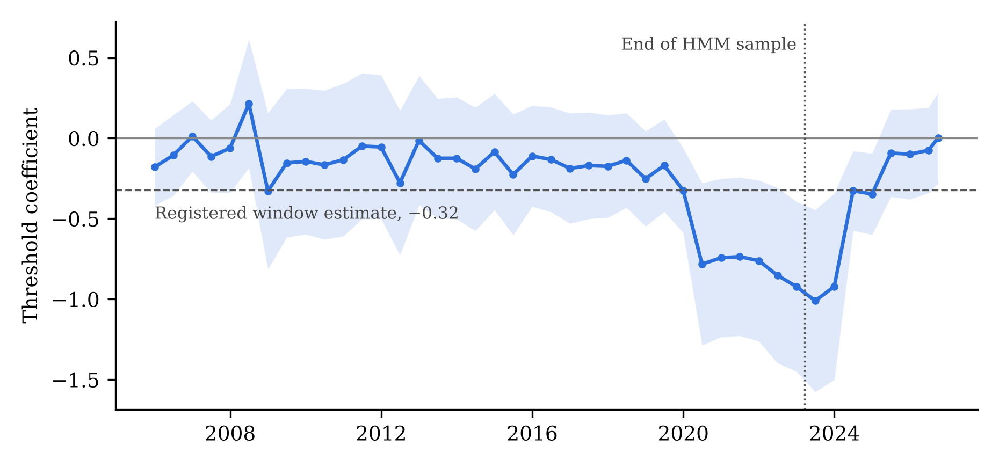
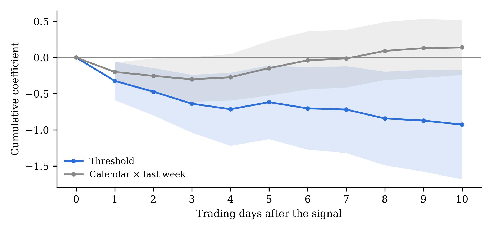

**Abstract.** Investors who hold fixed shares of equities and bonds must sell equities after they outperform and buy after they lag. Harvey, Mazzoleni and Melone (2026) show that signals built from this drift predict next-day US equity-minus-bond returns. This paper asks whether local signals do the same in Canada and Australia, two markets chosen by a data rule and tested under rules committed before their equity data were used. Over 1999 to March 2023, the local Threshold signal predicts lower next-day equity-minus-bond returns, with a pooled coefficient of −0.32 (t = −3.10), close to the US value of −0.37. One standard deviation of the signal is worth about 14 basis points the next day. The result survives every inference method, outlier treatment and placebo tried. It is not stable over time. It is concentrated in 2008 and 2020 to 2022, is not significant outside those years, and is absent since March 2023. A month-end signal behaves like temporary price pressure but does not survive a multiple-testing adjustment.

**Keywords:** rebalancing; price pressure; return predictability; replication; pre-registration

**JEL classification:** G11, G12, G14, G23

# 1. Introduction

Pension funds, balanced funds and target-date funds hold fixed shares of equities and bonds. When equities outperform, the equity share drifts up and the rule says sell. Harvey, Mazzoleni and Melone (2026), hereafter HMM, show that this mechanical selling is predictable and moves prices. When a simulated 60/40 portfolio is overweight equities, next-day US equity returns are lower relative to bonds. They put the cost to US investors at about $16 billion a year.

HMM's evidence outside the US uses US signals to predict non-US equity returns. That captures US investors trading abroad. It does not ask whether local rebalancing moves local prices. If the mechanism is general, local signals should work in other markets with large fixed-allocation investors, separately from the US signal.

This paper tests that in Canada and Australia. Both have large pension and superannuation systems. Both were admitted by a bond-data rule and tested under rules committed before their equity data were used. An earlier paper tested the UK and Germany under an earlier design and found limited support (Ratnaike, 2026). The design used here was written after those results were seen. Section 3 sets out that history in full.

The paper makes three points. First, the Threshold signal replicates in the new markets at close to the US size. Second, it holds with the US signal in the regression, so it is not a spillover from US trading, though in Australia its significance depends on that control. Third, the effect is not a constant. It appears in volatile periods and is absent in calm ones and since 2023. That pattern matters for anyone estimating the cost of rebalancing from a long sample, and it points to a question this paper cannot answer: whether rebalancing behaviour itself changes with market stress.

# 2. Relation to prior work

Table 1 sets out the closest evidence. Month-end return patterns are documented across many countries, but as average effects. The signals here predict the direction of returns from the signed drift of a fixed-allocation portfolio, and an indicator for the last week of the month absorbs any average month-end effect.

\begin{table}[H]\small
\caption{Closest prior evidence}
\begin{tabular}{L{2.4cm}L{2.9cm}L{2.9cm}L{5.6cm}}
\toprule
Study & Markets and period & Signal or flow & Main finding \\
\midrule
HMM (2026) & US, about 1998 to March 2023 & US 60/40 Threshold and Calendar signals & Equity returns about 17 bp lower the next day when stocks are overweight; US signals also predict non-US equity returns \\
Kayaçetin (2026) & 30 countries, 1994 to 2023 & Turn of the month & About 10 bp a day around month-end, about zero otherwise; linked to scheduled rebalancing \\
McConnell and Xu (2008) & 35 countries & Turn of the month & Effect present in 31 of 35 countries \\
Etula et al. (2020) & US and other markets & Month-end cash needs & Month-end return patterns in equities and Treasuries linked to institutional liquidity needs \\
Parker et al. (2023) & US & Target-date fund rebalancing & Contrarian rebalancing creates temporary price pressure in stocks the funds hold \\
Da et al. (2018) & Chile & Pension fund switching & Coordinated switches moved equities, bonds and currency, then reversed \\
Camanho et al. (2022) & Funds in US, UK, euro area, Canada & Cross-country equity rebalancing & Rebalancing out of foreign markets moves exchange rates \\
This paper & Canada and Australia; UK, Germany and US for comparison & Local 60/40 signals, US signal as control & Local Threshold signal predicts; effect concentrated in 2008 and 2020 to 2022 \\
\bottomrule
\end{tabular}
\end{table}

# 3. Data, method and registration history

**Signals.** For each market, a simulated portfolio holds 60% in the local equity index and 40% in a local 10-year government bond. With equity price return $r^e$ and bond price return $r^b$, the equity weight drifts as

$$w_t = \frac{w_{t-1}(1+r^e_t)}{w_{t-1}(1+r^e_t) + (1-w_{t-1})(1+r^b_t)}. \tag{1}$$

For a band $\delta$, the deviation is $s^\delta_t = w^\delta_t - 0.6$, and the weight is reset to 0.6 after any close where $|s^\delta_t| > \delta$. The Threshold signal averages 26 bands:

$$T_t = \frac{1}{26}\sum_{\delta \in \{0, 0.001, \ldots, 0.025\}} s^\delta_t. \tag{2}$$

The Calendar signal $C_t$ is the same deviation in a portfolio reset at each month-end close, and $L_t$ is 1 in the last five trading days of the month. The bond return is the price change of a 10-year par bond at the new yield, with no carry, so equity and bond returns are on the same price basis.

**Regression.** With $y_{t+1}$ the next day's equity-minus-bond return,

$$y_{t+1} = a + b_T T_t + b_C C_t L_t + g_1 C_t + g_2 L_t + g_3 M_t + g_4 y_t + d_T T^{US}_{t^*} + d_C C^{US}_{t^*} L^{US}_{t^*} + e_{t+1}, \tag{3}$$

following HMM. $M_t$ is momentum: half the average sign of past cumulative returns over 11 to 20 days, plus half the average over 1, 2, 3, 6 and 12 months. $t^*$ is the last US close before the local close. Negative $b_T$ and $b_C$ mean an equity overweight predicts lower equity returns relative to bonds.

**Data.** Equity indices are the S&P/TSX Composite, S&P/ASX 200, FTSE 100, DAX price index and S&P 500. Yields are the Bank of Canada, Reserve Bank of Australia, Bank of England and US Treasury 10-year series, and the ECB euro-area AAA curve for Germany. The main window is January 1999 (Canada January 2002) to 17 March 2023, the end of HMM's sample. The later period runs to 30 September 2026.

**Inference.** The primary test pools Canada and Australia with market-specific constants and controls, common signal coefficients and standard errors clustered by date. A second primary test interacts the signals with an indicator for dates after 20 March 2023. Multiple testing is adjusted by Holm's method, as registered.

**Registration history.** The order of events matters for reading the results.

1. *5 October 2026.* The original design, covering the UK and Germany, was committed before their data were used. Under it, no Threshold result was supported. Those results are reported in Ratnaike (2026).
2. *8 October.* After seeing those results and a US check over 2023 to 2025, a new design was committed. It changed the question to local signals in markets not yet studied, set the common price-return basis, fixed equation (3), and set a rule for admitting markets: an official daily 10-year yield from 2005 whose bond returns track a traded bond fund on the same day. Japan, Sweden and Switzerland failed the rule. No qualifying series could be obtained for France, the Netherlands, Spain or Italy. Canada and Australia passed.
3. *11 October.* The primary tests were run once. An audit then found that bond returns had been computed before alignment to equity dates. Correcting this moved the pooled Threshold estimate from −0.314 (t = −3.06) to −0.321 (t = −3.10). All results below are after this correction.
4. *12 October.* Further checks were added after the primary results: a wild bootstrap, Romano–Wolf adjustment, IVX, the Ibragimov–Müller test, local projections and out-of-sample tests. They are labelled as later checks.

Canada and Australia were therefore tested before their equity data were used, but under rules written after other markets had been seen. The UK result in Table 2 uses the common price basis adopted on 8 October. Under the original basis it was −0.180 (t = −1.57).

# 4. Results

\begin{table}[H]\small
\caption{Signal coefficients, January 1999 (Canada 2002) to 17 March 2023}
\begin{tabular}{lcc}
\toprule
 & Threshold & Calendar × last week \\
\midrule
\textbf{Canada and Australia, pooled} & \textbf{−0.321 (−3.10)} & −0.201 (−2.67) \\
\quad Holm-adjusted p (registered) & 0.034 & 0.085 \\
\quad Wild bootstrap p / Romano–Wolf p (later checks) & 0.004 / 0.019 & 0.008 / 0.067 \\
Canada & −0.368 (−2.12) & −0.240 (−2.40) \\
Canada, same-day US signal & −0.505 (−3.00) & −0.071 (−0.67) \\
Australia & −0.282 (−2.17) & −0.161 (−2.64) \\
Australia, without US signals & −0.207 (−1.91) & \\
UK (studied earlier) & −0.247 (−2.74) & −0.150 (−3.06) \\
Germany, 2014 to 2023 (studied earlier) & +0.127 (0.79) & +0.116 (1.57) \\
US (studied earlier) & −0.368 (−3.20) & −0.206 (−2.84) \\
\bottomrule
\end{tabular}

\footnotesize t-statistics in brackets. Pooled: clustered by date. Single markets: Newey–West. Holm p-values are from the registered run before the alignment correction (Section 3). Single new markets do not pass the Holm adjustment.
\end{table}

**Size.** The pooled coefficient of −0.32 means a one-percentage-point equity overweight predicts an equity-minus-bond return 32 basis points lower the next day. The signal's standard deviation is 0.45 percentage points, so a typical deviation is worth about 14 basis points. HMM report about 17 basis points for the US. The size is similar.

**Inference.** The pooled Threshold result passes the registered Holm adjustment. It also passes the later checks: the wild bootstrap by date, Romano–Wolf across 14 tests, multivariate IVX (Canada t = −2.61, Australia t = −2.59) and Driscoll–Kraay errors (t = −2.35). Canada and Australia's coefficients cannot be told apart (Wald p = 0.57). With only two markets, the Ibragimov–Müller test is weak (p = 0.08). Out of sample from 2010, the forecast beats the historical mean in Australia (Clark–West t = 2.27, out-of-sample R² +0.19%) but not in Canada (t = 1.61, R² −0.37%).

**Local, not spillover.** The result holds with the US signals in the regression. In Australia, though, the local signal is only marginal without them (t = −1.91), so part of its significance comes from separating it from the US signal. A signal built from a global equity index instead of the local one predicts nothing in the UK, Germany or Australia (where the global series starts in 2006). In Canada it does: the global Calendar signal has t = −3.33, and alongside it the local Threshold signal falls below significance (t = −1.87). For Canada, local and global rebalancing cannot be cleanly separated.

**Canada's timing.** Canada closes with the US, so the registered rule gives it the previous day's US signal. With the same-day US signal, the Threshold result strengthens and the month-end result disappears.

# 5. Stability over time

The registered stability split divides the window at 2009. The pooled Threshold coefficient is −0.246 (t = −1.81) over 1999 to 2008 and −0.376 (t = −2.58) over 2009 to March 2023. The split hides where the effect comes from. Figure 1 shows the coefficient in rolling four-year windows.

{width=95%}

\begin{table}[H]\small
\caption{Stability of the pooled Threshold coefficient}
\begin{tabular}{lc}
\toprule
Period or test & Coefficient (t) \\
\midrule
1999 to 2008 (registered split) & −0.246 (−1.81) \\
2009 to March 2023 (registered split) & −0.376 (−2.58) \\
1999 to 2019 & −0.180 (−2.10) \\
2009 to 2019 & −0.120 (−1.13) \\
2020 to March 2023 & −0.998 (−3.07) \\
March 2023 to September 2026 & +0.064 (0.43) \\
1999 to September 2026, excluding 2020 to 2023 & −0.145 (−1.81) \\
Registered window, excluding February to May 2020 & −0.200 (−2.51) \\
\midrule
Change after March 2023, controls fixed (registered) & +0.032 [−0.098, 0.162] \\
Change after March 2023, all coefficients free & +0.386 (2.11) \\
\bottomrule
\end{tabular}

\footnotesize Rows other than the registered split and the registered change test were not registered.
\end{table}

Three facts stand out from Figure 1 and Table 3. No four-year window ending before December 2019 has a t-statistic beyond 1.7. Windows covering 2020 to 2022 show coefficients two to three times the full-window value. Since 2023 the coefficient is about zero.

The two tests of change after March 2023 disagree. The registered test holds the control coefficients fixed across periods and finds no change. A test that lets every coefficient change finds a significant decline (t = 2.11). The second is the more natural test, and it says the effect has weakened. Each market, taken alone, also changes sign or loses significance across sub-periods: Canada is −0.48 over 1999 to 2008, +0.10 over 2009 to 2019 and −1.46 over 2020 to 2022.

Why the effect comes and goes is not tested here. Two readings fit. Rebalancing pressure may matter only when liquidity is scarce and price swings are large, so it shows up in crashes and their aftermath. Or the effect may have been traded away after HMM circulated from early 2025, as McLean and Pontiff (2016) find for many published patterns. The data cannot yet separate the two.

# 6. Robustness and mechanism

\begin{table}[H]\small
\caption{Robustness of the pooled Threshold result, registered window}
\begin{tabular}{lc}
\toprule
Check & Coefficient (t) \\
\midrule
Base & −0.321 (−3.10) \\
Returns winsorised at 1\% and 99\% & −0.245 (−3.31) \\
Dropping the 25 most influential dates & −0.194 (−2.45) \\
Adding four further lagged returns & −0.349 (−2.70) \\
Adding 5-day and 20-day cumulative returns & −0.341 (−2.70) \\
Two lagged S\&P 500 returns as controls & −0.315 \\
Standard errors: HC1 / Driscoll–Kraay (20 lags) & t = −3.63 / −2.42 \\
Signal shifted at random, 200 draws & none reach |t| of 3.10 \\
Single bands, 0\% to 2.5\% (t only) & −1.50 to −2.40 \\
\bottomrule
\end{tabular}
\end{table}

Outliers matter for size but not sign. Winsorising and dropping influential dates, mostly in March 2020 and late 2008, cut the coefficient by up to 40% and leave it significant. The result is not short-run reversal of recent returns: cumulative past returns have no predictive power of their own (t = −0.16), and adding them leaves the coefficient unchanged. Averaging across bands strengthens the result; single bands give t-statistics between −1.50 and −2.40.

{width=95%}

The Threshold effect works through equities (equity leg −0.268, t = −2.77). It does not reverse within ten days (Figure 2). The cumulative coefficient grows to about −0.93. A persistent signal can produce this mechanically, so the absence of reversal is not decisive evidence against price pressure. The month-end effect behaves as price pressure should. It appears only in the last week of the month (placebo weeks one to three give +0.17, +0.07 and +0.10, none significant), and it reverses within ten days. It fails the Holm and Romano–Wolf adjustments and Canada's same-day check, so it is not claimed.

**Economic value.** A cost-free trade on the sign of the signal earns a Sharpe ratio of −0.02 in Canada and 0.29 in Australia over the registered window. The predictability is statistically robust but too small to exploit on its own.

# 7. Conclusion

\begin{table}[H]\small
\caption{Summary}
\begin{tabular}{L{5.0cm}L{2.8cm}L{6.0cm}}
\toprule
Question & Answer & Evidence \\
\midrule
Does a local Threshold signal predict outside the US? & Yes, 1999 to March 2023 & −0.32 (t = −3.10); Holm p = 0.034 \\
Is it the same size as in the US? & Similar & About 14 bp per standard deviation, against HMM's 17 bp \\
Is it local rather than US spillover? & Mostly & Holds with US controls; Australia needs them; Canada mixes with global signals \\
Is it stable? & No & Concentrated in 2008 and 2020 to 2022; −0.145 (t = −1.81) without 2020 to 2023 \\
Has it survived since March 2023? & No & +0.06 (t = 0.43); full break test t = 2.11 \\
Is it robust to method and outliers? & Yes & All inference methods, winsorising, placebo \\
Does the month-end signal hold? & Not established & Reverses as pressure should; fails multiple-testing adjustment \\
\bottomrule
\end{tabular}
\end{table}

Local rebalancing signals predicted next-day equity-minus-bond returns in Canada and Australia at about the US size. The effect is real in the window HMM studied, but it lives in a few volatile years and has not been present since 2023. Estimates of the cost of predictable rebalancing from long samples will overstate the cost in calm markets and understate it in stressed ones.

The natural next question is behavioural. If rebalancing pressure appears only in stress, then either institutions rebalance differently in stress or the market absorbs their trades differently. Measuring what institutions and other investors actually do after large moves, rather than inferring it from prices, is the subject of further work.

**Data and code.** All data are public. The registrations, amendments, code and results are in a public repository, in the order in which they were committed.

# References

Camanho, N., Hau, H., and Rey, H. (2022). Global portfolio rebalancing and exchange rates. *Review of Financial Studies* 35(11), 5228–5274.

Clark, T. E., and West, K. D. (2007). Approximately normal tests for equal predictive accuracy in nested models. *Journal of Econometrics* 138(1), 291–311.

Da, Z., Larrain, B., Sialm, C., and Tessada, J. (2018). Destabilizing financial advice: evidence from pension fund reallocations. *Review of Financial Studies* 31(10), 3720–3755.

Driscoll, J. C., and Kraay, A. C. (1998). Consistent covariance matrix estimation with spatially dependent panel data. *Review of Economics and Statistics* 80(4), 549–560.

Etula, E., Rinne, K., Suominen, M., and Vaittinen, L. (2020). Dash for cash: monthly market impact of institutional liquidity needs. *Review of Financial Studies* 33(1), 75–111. https://doi.org/10.1093/rfs/hhz054

Harvey, C. R., Mazzoleni, M., and Melone, A. (2026). The unintended consequences of rebalancing. NBER Working Paper 33554, revised January 2026.

Holm, S. (1979). A simple sequentially rejective multiple test procedure. *Scandinavian Journal of Statistics* 6(2), 65–70.

Ibragimov, R., and Müller, U. K. (2010). t-statistic based correlation and heterogeneity robust inference. *Journal of Business and Economic Statistics* 28(4), 453–468.

Kayaçetin, N. V. (2026). Infrequent rebalancing, risk deferral, and equity returns at the turn of the month. *Journal of International Financial Markets, Institutions and Money* 109, 102309.

Kostakis, A., Magdalinos, T., and Stamatogiannis, M. P. (2015). Robust econometric inference for stock return predictability. *Review of Financial Studies* 28(5), 1506–1553.

McConnell, J. J., and Xu, W. (2008). Equity returns at the turn of the month. *Financial Analysts Journal* 64(2), 49–64.

McLean, R. D., and Pontiff, J. (2016). Does academic research destroy stock return predictability? *Journal of Finance* 71(1), 5–32.

Parker, J. A., Schoar, A., and Sun, Y. (2023). Retail financial innovation and stock market dynamics: the case of target date funds. *Journal of Finance* 78(5), 2673–2723.

Ratnaike, Y. (2026). Do local rebalancing signals predict European equity returns? Evidence from the UK and Germany. Working paper.

Romano, J. P., and Wolf, M. (2005). Stepwise multiple testing as formalized data snooping. *Econometrica* 73(4), 1237–1282.
